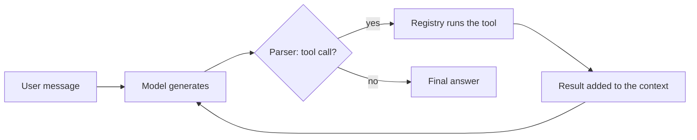

# SLM: a small LLaMA-style language model, built from scratch

A 15.7M-parameter decoder-only transformer written from scratch in PyTorch. It has the main parts of the LLaMA architecture (RoPE, grouped-query attention, RMSNorm, SwiGLU), a KV cache for fast generation, a full training pipeline on TinyStories, and a ReAct-style agent layer with a tool registry.

This is a learning project. The model is small on purpose, so the whole pipeline — tokenize, train, sample, run an agent loop — can be read, run and changed quickly.

## What's in it

- **Model:** a LLaMA-style decoder with RoPE, grouped-query attention (6 query heads, 2 KV heads), pre-norm RMSNorm, SwiGLU feed-forward layers and tied input/output embeddings.
- **Inference:** a KV cache for autoregressive generation, with greedy, temperature, top-k and top-p sampling.
- **Training:** a TinyStories data pipeline, AdamW with warmup and cosine decay, gradient accumulation, mixed precision, and checkpoints that training can resume from.
- **Agent layer:** a ReAct loop, a parser for tool calls, and an extensible tool registry (calculator, memory, clock).

## Architecture

```
SLM: ~15.7M parameters
├── Token embedding: 3.15M (vocab 8,192 × d_model 384)
├── 8 × transformer block: 12.6M in total
│   ├── RMSNorm (pre-attention)
│   ├── Grouped-query attention: 6 query heads, 2 KV heads, head dim 64
│   │   └── RoPE on queries and keys
│   ├── RMSNorm (pre-FFN)
│   └── SwiGLU feed-forward (hidden size 1,024)
├── Final RMSNorm
└── Output projection: tied to the token embedding

Context window: 512 tokens
Training data: TinyStories (~2.1M short stories)
```

### Why each component

| Component | What it does here |
|---|---|
| RoPE | Encodes position by rotating query and key vectors, so attention scores depend on relative position. Trained and used at 512 tokens; there is no context extension. |
| Grouped-query attention | 6 query heads share 2 key/value heads, which makes the KV cache 3x smaller: 4 KiB per token in fp16 (2 × 8 layers × 2 KV heads × 64 dims × 2 bytes) against 12 KiB with standard multi-head attention. |
| RMSNorm, pre-norm | Normalizes the input to each sublayer, which keeps training stable. RMSNorm skips LayerNorm's mean subtraction. |
| SwiGLU | The gated feed-forward layer LLaMA uses: three projections instead of two. |
| Tied embeddings | The output layer reuses the embedding matrix, saving 3.15M parameters. |

## Quick start

### Install

```bash
git clone https://github.com/SahilVankudre/slm.git
cd slm
pip install -r requirements.txt
```

### Train

```bash
# Quick test (100 steps, small dataset)
python scripts/train.py --test

# Full training
python scripts/train.py \
    --batch_size 32 \
    --max_steps 20000 \
    --learning_rate 3e-4 \
    --use_amp

# Resume from a checkpoint
python scripts/train.py --resume_from checkpoints/checkpoint_step_10000.pt
```

### Generate and chat

```bash
# Interactive chat (normal mode)
python scripts/chat.py --checkpoint checkpoints/best_model.pt --mode normal

# Agent mode (with tools)
python scripts/chat.py --checkpoint checkpoints/best_model.pt --mode agent
```

## Project structure

```
slm/
├── src/
│   ├── model/
│   │   ├── config.py           # Model configuration
│   │   ├── normalization.py    # RMSNorm
│   │   ├── rope.py             # Rotary positional embeddings
│   │   ├── attention.py        # Grouped-query attention + KV cache
│   │   ├── ffn.py              # SwiGLU feed-forward
│   │   ├── block.py            # Transformer block
│   │   └── slm.py              # Top-level model
│   │
│   ├── tokenizer/
│   │   └── tokenizer.py        # BPE tokenizer
│   │
│   ├── training/
│   │   ├── dataset.py          # TinyStories data pipeline
│   │   ├── trainer.py          # Training loop
│   │   └── scheduler.py        # Warmup + cosine LR schedule
│   │
│   ├── inference/
│   │   ├── sampler.py          # Sampling strategies
│   │   └── generate.py         # Generation interface
│   │
│   └── agent/
│       ├── tools.py            # Tool registry + implementations
│       ├── parser.py           # Parser for tool calls in model output
│       └── agent.py            # ReAct loop
│
├── scripts/
│   ├── train.py                # Training entry point
│   └── chat.py                 # Interactive chat CLI
│
├── requirements.txt
└── README.md
```

## Usage

### Python API

```python
import torch

from src.model.slm import SLM
from src.model.config import ModelConfig
from src.tokenizer.tokenizer import Tokenizer
from src.inference.generate import Generator

# Load the model
config = ModelConfig()
model = SLM(config)
model.load_state_dict(torch.load("checkpoints/best_model.pt"))

# Create a generator
tokenizer = Tokenizer()
generator = Generator(model, tokenizer, device="cuda")

# Generate text
output = generator.generate(
    "Once upon a time",
    max_new_tokens=100,
    temperature=0.8,
    top_p=0.9,
)
print(output)
```

### Chat commands

When running `scripts/chat.py`:

```
/help       - Show available commands
/reset      - Clear conversation history
/agent      - Switch to agent mode
/normal     - Switch to normal mode
/preset X   - Use a sampling preset (greedy, creative, balanced, focused, precise)
/verbose    - Toggle debug output
/exit       - Exit chat
```

## Agent layer



`parser.py` extracts a tool call from the model's output, the registry runs it, and the result goes back into the context for the next step. The loop takes any generator, so the parser, registry and loop can be tested with scripted outputs or with a larger model.

**Tool use and model size.** TinyStories contains no tool-call examples, so a model trained only on it isn't expected to produce the tool-call format reliably. Getting reliable tool use from this model needs fine-tuning on tool-call transcripts (see Next steps).

```python
from src.agent.agent import Agent

agent = Agent(generator, verbose=True)

# Routes to the calculator when the model emits a well-formed tool call
response = agent.run("What is 15 times 7?")

# Multi-turn conversation
agent.chat("Remember my name is Alice")  # memory tool
agent.chat("What time is it?")           # clock tool
agent.chat("What's my name?")            # reads from memory
```

### Adding a tool

```python
from src.agent.tools import Tool, ToolRegistry

class CustomTool(Tool):
    def __init__(self):
        super().__init__()
        self.name = "my_tool"
        self.description = "Does something useful"
        self.parameters = {"arg1": "Description of arg1"}

    def execute(self, arg1: str) -> str:
        # Your tool logic here
        return f"Processed: {arg1}"

registry = ToolRegistry()
registry.register(CustomTool())
```

### Custom sampling

```python
from src.inference.sampler import Sampler

# Write your own sampler
def my_sample(logits, param=1.0):
    # Your sampling logic
    return sampled_tokens

# Or use the built-in options
output = generator.generate(
    prompt,
    temperature=0.7,
    top_k=50,
    top_p=0.9,
)
```

## Configuration

### Model

| Parameter | Value | Description |
|---|---|---|
| `d_model` | 384 | Hidden dimension |
| `n_layers` | 8 | Transformer blocks |
| `n_heads` | 6 | Query heads (head dim 64) |
| `n_kv_heads` | 2 | Key/value heads (GQA) |
| `d_ff` | 1,024 | SwiGLU hidden size |
| `max_seq_len` | 512 | Context window |
| `vocab_size` | 8,192 | Tokenizer vocabulary |

### Training

| Parameter | Default | Description |
|---|---|---|
| `batch_size` | 32 | Sequences per micro-batch |
| `gradient_accumulation_steps` | 4 | Effective batch of 128 sequences |
| `max_steps` | 20,000 | Training steps |
| `learning_rate` | 3e-4 | Peak learning rate |
| `warmup_steps` | 2,000 | Linear warmup before cosine decay |
| `weight_decay` | 0.1 | AdamW weight decay |
| `--use_amp` | off | Mixed-precision training |

<!--
## Results

Fill this in from your training logs, then delete the comment markers around this section.
Every number here should come from a run you can reproduce.

| Metric | Value |
|---|---|
| Final validation loss | |
| Validation perplexity | |
| GPU | |
| Training time for 20,000 steps | |
| Training throughput (tokens/s) | |
| Generation speed with KV cache (tokens/s, batch size 1) | |


### Sample generations

Prompt: "Once upon a time"
> (paste a real output here, with the sampling settings you used)
-->

## Limitations

- **Small by design.** 15.7M parameters trained on simple children's stories. Output is fluent only in that domain.
- **512-token context.** RoPE isn't scaled, so quality past 512 tokens isn't expected.
- **Tool use** needs tool-call training data the model hasn't seen; see Agent layer.

## Next steps

- Fine-tune on tool-call transcripts so the agent loop runs on the model itself.
- Try position interpolation for RoPE and measure quality past 512 tokens.
- Compare grouped-query and standard multi-head attention at equal parameter count.

## Acknowledgments

- Architecture follows LLaMA (Meta AI).
- Training data: TinyStories (Eldan and Li, Microsoft Research).

## License

Released under the MIT License; see [LICENSE](LICENSE).

## Contact

Sahil Vankudre · [GitHub](https://github.com/SahilVankudre) · [LinkedIn](https://linkedin.com/in/sahil-vankudre-175a6036b)
